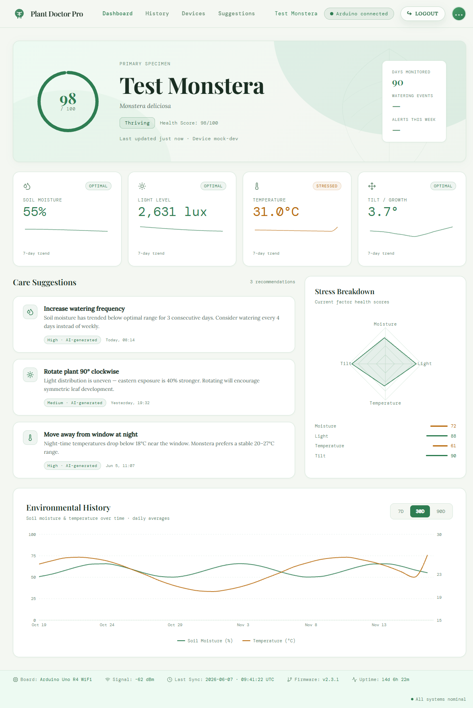

# plant-doctor-pro
A stress-aware plant care system using Arduino UNO R4 WiFi. Monitors soil moisture, light, temperature &amp; growth in real time. Local feedback via OLED &amp; LED matrix. Sensor data synced to Supabase for deep health analysis &amp; displayed on a web dashboard.

**Live dashboard:** https://plant-doctor-pro-frontend.onrender.com
(login required. Data is scoped per account, so a new account starts empty.)

*Screenshot uses the synthetic data from `VITE_USE_MOCK=true`.*

## Documentation

Project docs live in [docs/](docs/) — see the [index](docs/README.md).
Start with [docs/plan.md](docs/plan.md); **Phase 5** lists the currently open issues.

## Layout

| Path | Contents |
|---|---|
| [arduino/plant_doctor_pro/](arduino/plant_doctor_pro/) | Firmware — sensors, filtering, status logic, WiFi POST |
| [web/backend/](web/backend/) | Express API gateway + Supabase schema and SQL |
| [web/frontend/](web/frontend/) | React dashboard (Vite) |
| [docs/](docs/) | Plan, work logs, test plans |
