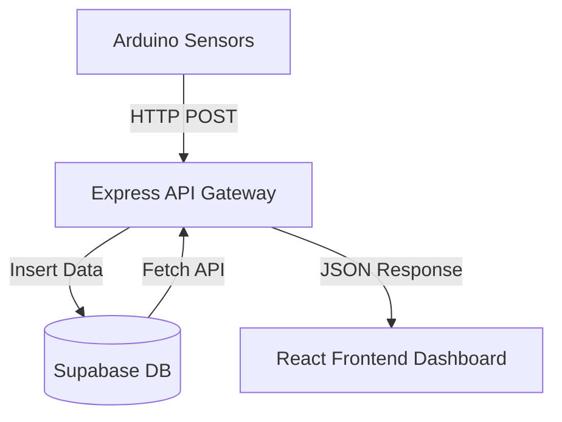

# Implementation Plan: Plant Doctor Pro

This document maps out the roadmap for fully integrating the Arduino hardware layer, the Supabase PostgreSQL database, the Node.js/Express API gateway, and the React front-end dashboard.

---

## Roadmap Overview



---

## Current Status (2026-07-25)

Phases 1–4 are **done**. The full path *Arduino → Express → Supabase* was verified over
the LAN on **2026-07-09** (see [test-lan-2026-07-01.md](test-lan-2026-07-01.md)):
readings landed in `plant_data` every 5 minutes (10 samples × 30 s, averaged), and the
dashboard runs on live data (`VITE_USE_MOCK=false`).

That single session is **all the data there is** — the device has not been powered since,
so the newest reading is from 2026-07-09. Nothing is broken; the soak test (5.4) simply
has not started.

What remains is **Phase 5** below — data-quality and reliability problems that the
happy-path test did not cover.

> ⚠ **5.1 is written but unproven on hardware** — the moisture-to-percent firmware has
> not been compiled or uploaded, and its calibration constants are still placeholders. The
> checklist is in
> [worklog-2026-07-25.md](worklog-2026-07-25.md).
> 5.2 is done.

---

## Step-by-Step Execution Plan

### Phase 1: Database Provisioning (Supabase)
Prepare the database tables and reference nodes for the devices.
1.  Log in to your **Supabase Dashboard** and create a new project.
2.  Navigate to the **SQL Editor** tab.
3.  Execute the script in [schema.sql](../web/backend/database/schema.sql) to generate the tables (`devices`, `plant_data`, `care_suggestions`).
4.  Execute the seed script in [mock_data.sql](../web/backend/database/mock_data.sql) to set up test devices and preliminary entries.
5.  Retrieve your **Supabase API URL** and **Service Role API Key** from the project settings.

### Phase 2: Express Backend Environment Configuration
Configure and start the middleware API.
1.  Navigate to [web/backend](../web/backend).
2.  Create a `.env` file containing:
    ```env
    SUPABASE_URL=YOUR_SUPABASE_PROJECT_URL
    SUPABASE_KEY=YOUR_SUPABASE_SERVICE_ROLE_OR_ANON_KEY
    ```
3.  Open a terminal inside [web/backend](../web/backend) and run:
    ```bash
    npm install
    npm run server
    ```
4.  Verify that the server launches successfully on `http://localhost:3000` and displays:
    `Server running on http://localhost:3000`
5.  *(Optional)* Smoke-test the endpoint with curl. The API is **write-only** — the read
    routes were removed in 5.8 step 2, so use a POST (see the command in
    [test-lan-2026-07-01.md](test-lan-2026-07-01.md)).

### Phase 3: Firmware & Arduino Sensor Integration
Complete the micro-controller logic to connect to WiFi and transmit actual metrics.
1.  Open the [arduino](../arduino) folder.
2.  Configure your local wireless SSID credentials in [wifi_post.ino](../arduino/plant_doctor_pro/wifi_post.ino).
3.  Complete [plant_doctor_pro.ino](../arduino/plant_doctor_pro/plant_doctor_pro.ino):
    *   Integrate library inclusions for your sensors (e.g. DHT11 temperature/humidity, soil moisture pin reads, light sensor, tilt switch).
    *   In `setup()`, call the WiFi initialization routine.
    *   In `loop()`, poll sensor values every $N$ seconds.
    *   Formulate a JSON string matching the expected backend input format:
        ```json
        {
          "device_id": "YOUR_DEVICE_UUID_FROM_SUPABASE",
          "moisture": 62.0,
          "light": 3400.0,
          "temperature": 22.4,
          "plant_status": "Thriving"
        }
        ```
    *   Execute an HTTP `POST` request to `http://<YOUR_BACKEND_IP>:3000/api/sensor-data` to submit the payload.

### Phase 4: Frontend Live Integration
Shift the dashboard from static mock data to dynamically fetching database logs.
1.  Update the fetch client configuration in [fetch-data.ts](../web/frontend/src/app/api/fetch-data.ts):
    *   Dynamically load the `device_id` relative to the selected plant/device.
2.  Update the components to ingest dynamic state instead of loading static mock data from [mock-plant.ts](../web/frontend/src/app/data/mock-plant.ts):
    *   Implement loading states and try/catch blocks for error boundaries.
    *   Configure dynamic ranges (7D/30D/90D) to request corresponding historical date-truncations from the backend.
3.  Integrate the visual dark botanical theme. In [App.tsx](../web/frontend/src/app/App.tsx), change:
    *   `background: "#F4F7F2"` $\rightarrow$ `background: "var(--plant-bg)"` (`#0D1F17`)
    *   `color: "#1A2E22"` $\rightarrow$ `color: "var(--plant-text)"` (`#F0EDE6`)
    *   Update card backgrounds from `#FFFFFF` to `var(--plant-card)` (`#1A3828`) and borders to `var(--plant-border)` (`#2D5A3D`) to fulfill the forest green theme guidelines.
4.  Navigate to [web/frontend](../web/frontend) and run:
    ```bash
    npm install
    npm run dev
    ```
5.  View the live dashboard at the URL provided by Vite.

---

## Phase 5: Open Issues (current work)

Problems found after live data started flowing, ordered by priority — quick wins first
within each tier.

| # | Issue | Priority |
|---|---|---|
| [5.9](#59--pick-your-own-device-after-login--done-2026-09-05) | Pick your own device after login + deploy the dashboard | ✅ done — dashboard live 2026-11-17 |
| [5.8](#58--backend-deployment-readiness--done-deployed-on-render) | Backend deployment readiness | ✅ done — deployed on Render |
| [5.1](#51--soil-moisture-is-uncalibrated-blocks-health-scoring--p1-code-done--needs-measuring) | Soil moisture is uncalibrated | P1 — code done, needs measuring |
| [5.2](#52--recorded_at-has-no-time-zone--p1-done-migration-run-2026-07-25) | `recorded_at` has no time zone | ✅ done |
| [5.3](#53--service_role-key-sits-in-the-frontend-env--done-2026-07-25) | `service_role` key sits in the frontend `.env` | ✅ done |
| [5.4](#54--no-long-run-reliability-data--p2-scheduled) | No long-run reliability data | P2 — scheduled with the hardware team |
| [5.5](#55--device-identity--pairing--p2) | Device identity & pairing | P2 |
| [5.6](#56--dashboard-sections-still-on-mock-data--p3) | Dashboard sections still on mock data | P3 |
| [5.7](#57--the-pipeline-depends-on-the-pc-being-awake--done-via-58) | The pipeline depends on the PC being awake | ✅ done (via 5.8) |

### 5.1 — Soil moisture is uncalibrated (blocks health scoring) — **P1, code done / needs measuring**

The firmware sent **raw analog** values (0-1023) while `plant_types.min_moisture` /
`max_moisture` and the UI both assume **percent**, so moisture was worked around in
three places instead of being used.

**Code changes (done):** the conversion lives in the firmware — `plant_data.moisture`
now only ever receives percent.

| File | Change |
|---|---|
| [config.h](../arduino/plant_doctor_pro/config.h) / [config.example.h](../arduino/plant_doctor_pro/config.example.h) | new `MOISTURE_RAW_DRY` / `MOISTURE_RAW_WET` calibration points |
| [sensor.ino](../arduino/plant_doctor_pro/sensor.ino) | `moistureToPercent()` — linear map, clamped to 0-100, `-1` passes through; `#error` if DRY <= WET |
| [datafiltering.ino](../arduino/plant_doctor_pro/datafiltering.ino) | averages raw, then converts once → `filtered_moisture_pct` |
| [plant_status.ino](../arduino/plant_doctor_pro/plant_status.ino) | thresholds are now `MOISTURE_PCT_DRY 30` / `MOISTURE_PCT_WET 80`, with a `-1` guard |
| [wifi_post.ino](../arduino/plant_doctor_pro/wifi_post.ino) | POSTs `filtered_moisture_pct` |
| [dashboard-view.ts](../web/frontend/src/app/api/dashboard-view.ts) | moisture is back in `computeHealth()`; card renders `%` via `inRange()` |

`plant_types.min_moisture` / `max_moisture` needed no change — all eight seeded species
in [mock_data.sql](../web/backend/database/mock_data.sql)
were already in percent.

**Remaining (hardware in the loop):**
1.  Read the two reference values off the Serial Monitor (`moisture(raw)=` line):
    probe **dry in open air**, then **submerged to the marked line**.
2.  Put them in `config.h` as `MOISTURE_RAW_DRY` / `MOISTURE_RAW_WET` and re-upload.
    The committed defaults (620 / 300) are typical capacitive values, not measured ones.
3.  Confirm the Serial Monitor prints a sane `Moisture: xx % (raw yyy)` and that a
    watered pot moves the number the right way.
4.  Deal with the raw rows from the 2026-07-09 LAN test — see
    [migrations/2026-07-25_moisture_to_percent.sql](../web/backend/database/migrations/2026-07-25_moisture_to_percent.sql).
    **The script is scoped to one `device_id` on purpose:** the demo rows seeded by
    `mock_data.sql` are already in percent (62.0, 52.0, …), and a blanket "convert
    everything before date X" would push them through the formula a second time and clamp
    them to 100. Deleting the test rows is the cleaner option here — they predate the
    calibration, so converting them is guesswork over data nobody needs.
5.  Re-check `MOISTURE_PCT_DRY` / `MOISTURE_PCT_WET` against how the plant actually
    behaves; 30/80 is a starting guess.

> The firmware was never compiled here (no `arduino-cli` on this machine) — verify it
> builds in the Arduino IDE before trusting the upload.

### 5.2 — `recorded_at` has no time zone — **P1, DONE (migration run 2026-07-25)**

[schema.sql](../web/backend/database/schema.sql)
declared `recorded_at TIMESTAMP DEFAULT NOW()` — *without* time zone. Postgres stores
UTC, PostgREST returned it with no offset (`2026-07-25T01:00:00`), and JavaScript's
`new Date()` parses an offset-less ISO string as **local time**. In KST that shifted every
reading by 9 hours: "last updated 9 hr ago" for a row that had just landed, and
`fetchReadings()`'s `.gte("recorded_at", since)` window off by the same amount.

**Code changes (done):**

| File | Change |
|---|---|
| [schema.sql](../web/backend/database/schema.sql) | all five `TIMESTAMP DEFAULT NOW()` columns are now `TIMESTAMPTZ` |
| [migrations/2026-07-25_timestamptz.sql](../web/backend/database/migrations/2026-07-25_timestamptz.sql) | converts the existing columns, reinterpreting stored values as UTC |
| [dashboard-view.ts](../web/frontend/src/app/api/dashboard-view.ts) | `buildHistory()` groups by `localDayKey()` instead of slicing the ISO string |

That last one is a second, independent bug: the chart bucketed by the **UTC** day while
`shortDate()` labelled in **local** time, so an evening KST reading was filed under the
previous day and two points could carry the same label. Bucketing now matches labelling.

Once the column carries an offset, no client-side date maths is needed — `new Date()`
parses it correctly on its own.

**Done:** the migration ran on 2026-07-25 — `plant_data.recorded_at` now returns with a
`+00` offset. Worth one more look at the dashboard the next time the device is sending, to
confirm "last updated" tracks minutes rather than hours.

### 5.3 — `service_role` key sits in the frontend `.env` — **DONE 2026-07-25**

`web/frontend/.env` carried `SUPABASE_KEY` (the **service role** secret) alongside the
`VITE_*` values. Vite only bundles `VITE_`-prefixed variables, so it never reached the
browser — but a secret with no reason to be in a client project is one rename away from
shipping.

**Done:**
- Removed `SUPABASE_URL` / `SUPABASE_KEY` from `web/frontend/.env`; it now holds only
  `VITE_SUPABASE_URL`, `VITE_SUPABASE_PUBLISHABLE_KEY` and `VITE_USE_MOCK`. The backend
  copy in `web/backend/.env` is untouched and is the only place the secret lives.
- Added committed `.env.example` templates for
  [frontend](../web/frontend/.env.example)
  and [backend](../web/backend/.env.example),
  each stating which side the key belongs on.
- Verified: `git log --all -- "*.env"` is empty, so **no `.env` was ever committed** and the
  key was never exposed through the repository — no rotation needed. The rebuilt bundle
  contains the publishable key and zero occurrences of the service-role JWT.

### 5.4 — No long-run reliability data — **P2, scheduled**

Planned as a 24 h run with the hardware team. A few successful cycles is not the same as
a stable pipeline — count rows against the expected rate. Run a **24–48 h soak test**
and count rows: 5-minute intervals should produce **288 rows/day** per device. The gap
between that and reality is the drop rate.

Things to verify while it runs:
- WiFi reconnect actually recovers (the `WiFi.status()` check in `loop()`).
- What the sketch does when the backend is **down** or returns 5xx — currently the
  averaged sample is simply lost, with no retry or buffering.
- PC sleep / reboot: the Express server stops, and so does the whole pipeline (see 5.7).
- Sensor failures over time — `-1` sentinels appearing in `plant_data`.

### 5.5 — Device identity & pairing — **P2 (unblocks 5.6 and 5.7)**

#### How a plant is picked today

```
login → auth.uid() → devices (filtered by RLS) → newest row → plant_data (by device_id)
```

[fetch-data.ts](../web/frontend/src/app/api/fetch-data.ts)
`fetchNewestDevice()` carries **no `user_id` filter** — it just takes the newest row by
`created_at`. Other users' plants stay hidden only because the RLS policy in
[policy.sql](../web/backend/database/policy.sql)
(`devices.user_id = auth.uid()`) filters them server-side. The same holds for
`plant_data`. That works, but it means the *client* has no notion of ownership.

#### The gap

The only thing tying a physical board to a `devices` row is the **`DEVICE_ID` UUID
hand-copied into `config.h`**, sent on every POST
([wifi_post.ino](../arduino/plant_doctor_pro/wifi_post.ino)).
The database stores no hardware identity at all, so these questions are unanswerable:

- Which physical board is attached to this plant? (no MAC / serial)
- Is the device alive right now? (no `last_seen_at` — only inferable from the newest
  `recorded_at`)
- What IP, signal strength, or firmware version? (printed to Serial, never transmitted)

**Security:** [sensor.js](../web/backend/database/sensor.js)
only checks that the `device_id` *exists*, and the backend uses the service-role key, which
bypasses RLS. **Anyone who knows a device UUID can write readings into someone else's
plant.** Low risk on a LAN; a blocker before 5.7 exposes the endpoint publicly.

**Multi-device:** with two plants, the older one is invisible — nothing in the UI can
switch devices. `fetchNewestDevice()` needs a `fetchDevices()` sibling plus a selector.

#### Fix

1.  Extend `devices` with the parts that are safe for the browser to read:
    ```sql
    ALTER TABLE devices
      ADD COLUMN mac_address      TEXT UNIQUE,   -- hardware identity
      ADD COLUMN last_seen_at     TIMESTAMPTZ,
      ADD COLUMN board_model      TEXT,
      ADD COLUMN firmware_version TEXT;
    ```
2.  Put the credential in its **own table**, never a column on `devices`:
    ```sql
    CREATE TABLE device_credentials (
        device_id    UUID PRIMARY KEY REFERENCES devices(id) ON DELETE CASCADE,
        secret_hash  TEXT NOT NULL,      -- SHA-256 of a high-entropy token
        created_at   TIMESTAMPTZ DEFAULT NOW(),
        last_used_at TIMESTAMPTZ
    );

    ALTER TABLE device_credentials ENABLE ROW LEVEL SECURITY;
    -- Deliberately NO policies: RLS denies by default, so authenticated users
    -- can read nothing. Only the backend's service-role key, which bypasses
    -- RLS, can read it.
    ```
    **Why not a column on `devices`:** the dashboard fetches
    `.select("*, plant_types(*)")`, and the SELECT policy filters *rows*, not columns — a
    `device_secret` column would be shipped straight to the browser. A separate table with
    no policies is safe even if someone writes `select("*")` again later. Store a hash;
    for a 192-bit random token SHA-256 is enough, since there is nothing to brute-force
    (bcrypt/argon2 exist for low-entropy human passwords).
3.  Have the firmware send `WiFi.macAddress()` in the POST body and its secret in the
    `X-Device-Secret` header; the backend rejects the insert unless the hash matches the
    `device_credentials` row for that `device_id`. **This is what upgrades 5.8's stopgap:**
    one shared secret proves "a device of ours", so a holder can post under any
    `device_id`; a per-device secret binds the credential to the row it may write.
4.  Touch `last_seen_at = now()` (and `device_credentials.last_used_at`) on every
    successful insert → online/offline badge, and real data for `DeviceFooter` (5.6).
5.  Add a device selector to the dashboard once more than one device exists.
6.  **Eventually, a pairing flow:** the web app issues a short code for a new device, the
    Arduino registers itself with that code and receives its `device_id`. This removes the
    hardcoded UUID entirely — swapping boards would no longer require reflashing.

### 5.6 — Dashboard sections still on mock data — **P3**

- **`CareSuggestions`** — imports `SUGGESTIONS` / `RADAR_DATA` from
  [mock-plant.ts](../web/frontend/src/app/data/mock-plant.ts).
  The `care_suggestions` table exists but nothing writes to it; the radar scores can be
  derived from the same per-factor scores `computeHealth()` already calculates.
- **`DeviceFooter`** — board / firmware / uptime / signal strength have **no columns in
  the schema**. Needs the schema addition described in **5.5** before it can show
  anything real.
- **Watering events** — no table, so watering markers were removed from the history
  chart. Add one if the feature is wanted.

### 5.7 — The pipeline depends on the PC being awake — **DONE (via 5.8)**

Originally the Arduino POSTed to the developer PC's LAN IP, so nothing is recorded when the PC
is off, asleep, or on another network. Two options:

- **A** — host the Express backend somewhere always-on (small VPS / container host) and
  point `SERVER_IP` at it. Keeps the validation layer in `sensor.js`.
- **B** — have the Arduino POST directly to the Supabase REST endpoint, dropping the
  middleware. Fewer moving parts, but the device then holds a Supabase key and the
  server-side validation is lost.

**Option A shipped** — the backend runs on Render (see 5.8 and
[deploy.md](deploy.md)), and since
2026-11-17 the dashboard does too, so neither half of the pipeline needs the PC any more. The
endpoint is not open: 5.8 step 3 added a shared device secret, which is the minimum that had to
land before exposing it. Full per-device identity is still 5.5.

Option B's trade-off got worse on inspection: posting straight to Supabase would put a
Supabase key on the device instead of a scoped secret, and lose the input validation added in
5.8 step 4.


### 5.8 — Backend deployment readiness — **DONE, deployed on Render**

All five steps below are done and the service `plant-doctor-pro-backend` is live on Render's
free tier, declared in [render.yaml](../render.yaml).

Deploying the Express backend was requested on 2026-08-11 (this is 5.7 option A). An audit
of what has to change first, worked **one step at a time, each reviewed before the next**.

Progress:

| Step | Scope | State |
|---|---|---|
| 1 | Make it start on a host — `PORT`, `start` script, Node version | ✅ `029ac8a` |
| 2 | Delete the unused read/write routes | ✅ |
| 3 | Lock down what remains — device secret, CORS, error bodies, rate limit | ✅ |
| 4 | Correctness — `.maybeSingle()`, input validation, fail-fast env, error/404 handlers, health check | ✅ |
| 5 | Housekeeping + deploy config | ✅ |

#### Step 1 — the service will not boot without these

- **`PORT` is hardcoded** to 3000 in
  [server.js](../web/backend/js/server.js).
  Every host injects its own `PORT`; ignoring it means the health check never passes and
  the deploy is killed. (The comment above the line already says "Read PORT which default
  to 3000" — only the implementation is missing.)
- **No `start` script.** `npm run server` uses `nodemon`, a devDependency that a production
  install omits.
- **`main` points at `server.js`** but the file is `js/server.js`, and no `engines.node` is
  declared.

#### Step 2 — delete the routes nobody uses

The frontend reads Supabase directly
([fetch-data.ts](../web/frontend/src/app/api/fetch-data.ts)),
so the only endpoint with a real caller is `POST /api/sensor-data`. Everything else in
[sensor.js](../web/backend/database/sensor.js)
is an unauthenticated hole, and the backend's service-role key bypasses RLS:

| Route | Exposure |
|---|---|
| `GET /api/sensor-data` | every reading of every user |
| `GET /api/sensor-data/:id` | any single reading |
| `GET /api/sensor-data/device/:device_id` | any device's full history |
| `PUT /api/sensor-data/:id` | anyone can rewrite any row |
| `DELETE /api/sensor-data/:id` | anyone can delete any row |

Deleting them removes most of the attack surface for free.

**Done.** `sensor.js` is now `POST /api/sensor-data` and nothing else, with a header comment
explaining why the rest are gone so they are not casually restored. Verified: GET / PUT /
DELETE on `/api/sensor-data` and `GET /api/sensor-data/device/:id` all return 404, while a
POST with no body still returns its 400.

#### Step 3 — lock down what remains

- `POST` accepts any known `device_id` with no proof of identity (5.5). Short of the full
  pairing flow, an `X-Device-Secret` header checked against an environment variable is
  enough to close it.
- `app.use(cors())` allows every origin — its own comment says "fine for dev/study".
- Every failure returns `error.message` straight from PostgREST, leaking schema details.
- No rate limit: an open POST endpoint can be used to fill the Supabase free tier.

**Done.** New [middleware.js](../web/backend/js/middleware.js)
holds both controls, mounted on `/api` ahead of the router:

| Control | Behaviour |
|---|---|
| `requireDeviceSecret` | compares `X-Device-Secret` against `DEVICE_SECRET` in constant time. **401** when missing or wrong, **503** when the env var is unset — it fails closed, because a missing variable silently disabling auth is how endpoints end up open in production |
| `rateLimit` | fixed one-minute window, 20 requests per IP, in memory, no dependency. Sweeps expired entries once it tracks more than 1000 IPs so the map cannot grow without bound. Sets `Retry-After` on the 429 |
| CORS | middleware removed entirely — the Arduino is not a browser, and the dashboard never calls this server |
| Error bodies | `error.message` from PostgREST named tables and constraints; responses are now a flat `Internal server error` with the real reason logged server-side |

`app.set('trust proxy', 1)` was added so `req.ip` is the device rather than the
platform's proxy — without it every caller shares one rate-limit bucket.

Firmware side: `DEVICE_SECRET` in `config.h`, sent via
`beginRequest()` / `sendHeader()` / `beginBody()` (the one-line `client.post()` form cannot
carry headers), and the Serial output now names 401 / 429 / 503 instead of a generic
"Failed to send data".

Verified against a running server: no header → 401, wrong secret → 401, right secret →
passes to the handler, unset env var → 503, 21st request in a minute → 429 with
`Retry-After: 50`, and a DB failure now answers `{"error":"Internal server error"}`.

**Still open here:** one shared secret for the whole fleet is the stopgap version of 5.5.
Per-device secrets need the pairing flow.

#### Step 4 — correctness

- **The 404 path is dead code.** `.single()` errors when no row matches, so an unknown
  `device_id` returns **500**, not the 404 the
  [LAN test cheatsheet](test-lan-2026-07-01.md)
  documents. `.maybeSingle()` fixes it.
- No input validation — `moisture: "abc"` becomes a 500. Now that moisture is a percentage,
  0–100 (plus the `-1` sentinel) is a checkable contract.
- `supabase.js` calls `createClient(undefined, undefined)` when the env vars are missing;
  it should fail at boot with a clear message.
- No global error handler, no 404 handler, no health endpoint (`GET /` is a 404).
- No SIGTERM handling, so in-flight requests are cut on redeploy.

**Done.**

| Change | Detail |
|---|---|
| `.maybeSingle()` | an unknown `device_id` now answers **404**, matching what the LAN cheatsheet always claimed. Verified against the live database |
| `validateReading()` | UUID shape, numeric types, and per-field ranges, all as 400s instead of Postgres 500s. **Moisture and humidity are validated as percent (0–100)**, so a raw ADC reading like `318.4` is rejected rather than stored in the wrong unit — the firmware must be calibrated and uploaded before the device posts again |
| `supabase.js` | exits at boot with the missing variable names instead of building a client from `undefined` |
| `GET /health` | mounted before the `/api` middleware, so no secret and no rate limit; reports uptime without touching the DB |
| 404 + error handlers | every response is JSON now, including unknown paths and unexpected throws. Express 5 routes async rejections to the error handler |
| SIGTERM / SIGINT | stop accepting connections, let in-flight requests finish, exit — with a 10 s cap so a stuck request cannot block a deploy |
| boot warning | logs immediately if `DEVICE_SECRET` is unset, rather than waiting for the first refused POST |

Verified: `/health` 200, unknown path `{"error":"Not found"}`, six malformed bodies each
rejected with a specific 400, a valid body reaching the DB and answering 404 for an unknown
device, and a missing `SUPABASE_URL` exiting 1 with a readable message. Signal handling was
not exercised locally — Windows has no real SIGTERM, so that path only runs on the host.

**Known wart, not fixed here:** `-1` doubles as the failed-read sentinel *and* a legal
temperature. Indoors it will not collide, but the honest fix is `null` from the firmware
rather than a magic number.

#### Step 5 — housekeeping and deploy config

- `uuid` is a dependency but is never imported.
- `morgan('dev')` → `combined` for production logs.
- Host settings: root directory `web/backend`, build `npm ci`, start `npm start`, env vars
  set in the dashboard (never a committed `.env`).
- **Host choice hinges on TLS.** The sketch uses a plain `WiFiClient`, and PaaS hosts
  redirect HTTP→HTTPS, which `ArduinoHttpClient` does not follow. Either switch the
  firmware to `WiFiSSLClient` on port 443 (a three-line change; Render's free tier then
  works) or pick a host that allows plain HTTP (Fly.io with `force_https = false`).
- After deploying: repoint `SERVER_IP` / `SERVER_PORT` in `config.h`.

**Done.** Full instructions now live in
[deploy.md](deploy.md).

| Change | Detail |
|---|---|
| Dependencies | dropped `uuid` (never imported), `cors` (middleware removed in step 3) and `vite` — the backend `package.json` had inherited the frontend's `dev`/`build` scripts and its Vite dev dependency. `npm ci --omit=dev` now installs five packages |
| Logging | `morgan('dev')` locally, `'combined'` when `NODE_ENV=production` — ANSI colour codes are noise in a platform log viewer |
| [render.yaml](../render.yaml) | Blueprint: `rootDir: web/backend`, `npm ci --omit=dev`, `npm start`, health check `/health`, the three secrets marked `sync: false` so they are prompted for and never committed |
| Firmware | `SERVER_IP` → `SERVER_HOST` plus a `USE_TLS` switch: `0` keeps the LAN setup byte-for-byte, `1` swaps `WiFiClient` for `WiFiSSLClient` on port 443. Serial now prints the full target URL |

**The host decision changed during this work.** Fly.io with plain HTTP was originally on the
table as "deploy without touching the firmware". Step 3 put `DEVICE_SECRET` in a header, and
plain HTTP means that header is readable by anything on the path — so TLS is now required and
Render's free tier is the recommendation. The `USE_TLS` toggle keeps local LAN debugging
available rather than trading one setup for the other.

### 5.9 — Pick your own device after login — **DONE 2026-09-05**

The dashboard opened whichever device `fetchNewestDevice()` returned and gave no way to
switch. Two things made that worse than it looked:

- **The "newest" device was arbitrary.** All three seeded rows share one `created_at`, so
  `.order("created_at").limit(1)` was a tie broken by whatever Postgres returned first — the
  plant on screen was often not the one with the Arduino attached.
- **Every device belonged to the wrong account.** They were owned by `b137c501…` while the
  account in use is `da20fe00…` (`yeesmn`), so logging in as the intended user showed the
  empty state. Fixed with a one-off `UPDATE devices SET user_id = …`.

**Changes:**

| File | Change |
|---|---|
| [fetch-data.ts](../web/frontend/src/app/api/fetch-data.ts) | `fetchNewestDevice()` → `fetchDevices()` (all of the user's plants, RLS-scoped) plus `fetchLastSeen()` for the newest reading per device |
| [Dashboard.tsx](../web/frontend/src/app/dashboard/Dashboard.tsx) | two effects — one loads user + devices, the other loads readings for whichever device is selected. Default: stored choice → most recently reporting device → first by name. Choice persists in `localStorage`, keyed by user id so accounts do not inherit each other's selection |
| [device-picker.tsx](../web/frontend/src/app/components/device-picker.tsx) | new dropdown: plant name, species, last-seen, and a status dot. One plant renders as a plain label — nothing to choose |
| [nav-bar.tsx](../web/frontend/src/app/components/nav-bar.tsx) | the hardcoded "Arduino Connected" pill is now derived: connected only if the selected plant reported within 15 minutes (three missed cycles), otherwise `Last seen …` |

Deployment is declared in [render.yaml](../render.yaml)
as a static site alongside the backend; the steps, including the Supabase Auth URL
configuration that sign-up emails depend on, are in
[deploy.md](deploy.md).

**Deployed 2026-11-17** at <https://plant-doctor-pro-frontend.onrender.com>. The first build
shipped `createClient(undefined, undefined)` — the `VITE_*` values were not set when it ran,
and Vite bakes them in at build time — so the page died on load with `supabaseUrl is
required`. Setting both variables and redeploying with a cleared build cache fixed it.

**Not included** (still 5.5 / 5.6): adding, renaming or removing plants from the UI, and the
`CareSuggestions` / `DeviceFooter` mock data.
