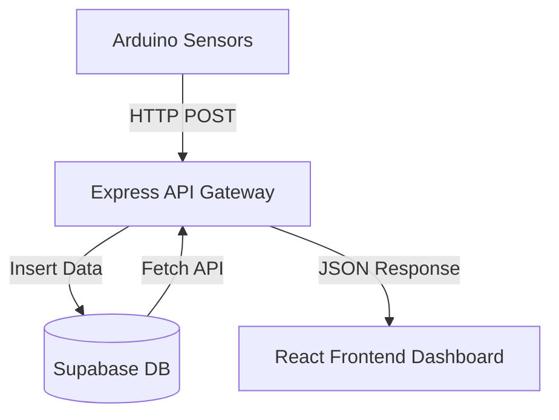

# Implementation Plan: Plant Doctor Pro

This document maps out the roadmap for fully integrating the Arduino hardware layer, the Supabase PostgreSQL database, the Node.js/Express API gateway, and the React front-end dashboard.

---

## Roadmap Overview



---

## Current Status (2026-07-25)

Phases 1–4 are **done**. The full path *Arduino → Express → Supabase* was verified over
the LAN (see [test-lan-2026-07-01.md](file:///c:/Users/yeesm/Work/arduino/plant-doctor-pro/docs/test-lan-2026-07-01.md)):
readings land in `plant_data` every 5 minutes (10 samples × 30 s, averaged), and the
dashboard runs on live data (`VITE_USE_MOCK=false`).

What remains is **Phase 5** below — data-quality and reliability problems that the
happy-path test did not cover.

---

## Step-by-Step Execution Plan

### Phase 1: Database Provisioning (Supabase)
Prepare the database tables and reference nodes for the devices.
1.  Log in to your **Supabase Dashboard** and create a new project.
2.  Navigate to the **SQL Editor** tab.
3.  Execute the script in [schema.sql](file:///c:/Users/yeesm/Work/arduino/plant-doctor-pro/web/backend/database/schema.sql) to generate the tables (`devices`, `plant_data`, `care_suggestions`).
4.  Execute the seed script in [mock_data.sql](file:///c:/Users/yeesm/Work/arduino/plant-doctor-pro/web/backend/database/mock_data.sql) to set up test devices and preliminary entries.
5.  Retrieve your **Supabase API URL** and **Service Role API Key** from the project settings.

### Phase 2: Express Backend Environment Configuration
Configure and start the middleware API.
1.  Navigate to [web/backend](file:///c:/Users/yeesm/Work/arduino/plant-doctor-pro/web/backend).
2.  Create a `.env` file containing:
    ```env
    SUPABASE_URL=YOUR_SUPABASE_PROJECT_URL
    SUPABASE_KEY=YOUR_SUPABASE_SERVICE_ROLE_OR_ANON_KEY
    ```
3.  Open a terminal inside [web/backend](file:///c:/Users/yeesm/Work/arduino/plant-doctor-pro/web/backend) and run:
    ```bash
    npm install
    npm run server
    ```
4.  Verify that the server launches successfully on `http://localhost:3000` and displays:
    `Server running on http://localhost:3000`
5.  *(Optional)* Test the REST endpoint using curl, Postman, or a browser:
    `GET http://localhost:3000/api/sensor-data`

### Phase 3: Firmware & Arduino Sensor Integration
Complete the micro-controller logic to connect to WiFi and transmit actual metrics.
1.  Open the [arduino](file:///c:/Users/yeesm/Work/arduino/plant-doctor-pro/arduino) folder.
2.  Configure your local wireless SSID credentials in [wifi_post.ino](file:///c:/Users/yeesm/Work/arduino/plant-doctor-pro/arduino/plant_doctor_pro/wifi_post.ino).
3.  Complete [plant_doctor_pro.ino](file:///c:/Users/yeesm/Work/arduino/plant-doctor-pro/arduino/plant_doctor_pro/plant_doctor_pro.ino):
    *   Integrate library inclusions for your sensors (e.g. DHT11 temperature/humidity, soil moisture pin reads, light sensor, tilt switch).
    *   In `setup()`, call the WiFi initialization routine.
    *   In `loop()`, poll sensor values every $N$ seconds.
    *   Formulate a JSON string matching the expected backend input format:
        ```json
        {
          "device_id": "YOUR_DEVICE_UUID_FROM_SUPABASE",
          "moisture": 62.0,
          "light": 3400.0,
          "temperature": 22.4,
          "plant_status": "Thriving"
        }
        ```
    *   Execute an HTTP `POST` request to `http://<YOUR_BACKEND_IP>:3000/api/sensor-data` to submit the payload.

### Phase 4: Frontend Live Integration
Shift the dashboard from static mock data to dynamically fetching database logs.
1.  Update the fetch client configuration in [fetch-data.ts](file:///c:/Users/yeesm/Work/arduino/plant-doctor-pro/web/frontend/src/app/api/fetch-data.ts):
    *   Dynamically load the `device_id` relative to the selected plant/device.
2.  Update the components to ingest dynamic state instead of loading static mock data from [mock-plant.ts](file:///c:/Users/yeesm/Work/arduino/plant-doctor-pro/web/frontend/src/app/data/mock-plant.ts):
    *   Implement loading states and try/catch blocks for error boundaries.
    *   Configure dynamic ranges (7D/30D/90D) to request corresponding historical date-truncations from the backend.
3.  Integrate the visual dark botanical theme. In [App.tsx](file:///c:/Users/yeesm/Work/arduino/plant-doctor-pro/web/frontend/src/app/App.tsx), change:
    *   `background: "#F4F7F2"` $\rightarrow$ `background: "var(--plant-bg)"` (`#0D1F17`)
    *   `color: "#1A2E22"` $\rightarrow$ `color: "var(--plant-text)"` (`#F0EDE6`)
    *   Update card backgrounds from `#FFFFFF` to `var(--plant-card)` (`#1A3828`) and borders to `var(--plant-border)` (`#2D5A3D`) to fulfill the forest green theme guidelines.
4.  Navigate to [web/frontend](file:///c:/Users/yeesm/Work/arduino/plant-doctor-pro/web/frontend) and run:
    ```bash
    npm install
    npm run dev
    ```
5.  View the live dashboard at the URL provided by Vite.

---

## Phase 5: Open Issues (current work)

Problems found after live data started flowing, ordered by priority — quick wins first
within each tier.

| # | Issue | Priority |
|---|---|---|
| [5.1](#51--soil-moisture-is-uncalibrated-blocks-health-scoring--p1) | Soil moisture is uncalibrated | P1 |
| [5.2](#52--recorded_at-has-no-time-zone--p1-quick) | `recorded_at` has no time zone | P1 (quick) |
| [5.3](#53--service_role-key-sits-in-the-frontend-env--p2-quick) | `service_role` key sits in the frontend `.env` | P2 (quick) |
| [5.4](#54--no-long-run-reliability-data--p2) | No long-run reliability data | P2 |
| [5.5](#55--device-identity--pairing--p2) | Device identity & pairing | P2 |
| [5.6](#56--dashboard-sections-still-on-mock-data--p3) | Dashboard sections still on mock data | P3 |
| [5.7](#57--the-pipeline-depends-on-the-pc-being-awake--p3) | The pipeline depends on the PC being awake | P3 |

### 5.1 — Soil moisture is uncalibrated (blocks health scoring) — **P1**

The firmware sends **raw analog** values (0–1023) while `plant_types.min_moisture` /
`max_moisture` and the UI both assume **percent**. Because the units don't match,
moisture is currently worked around in three places instead of being used:

| Where | Current workaround |
|---|---|
| [dashboard-view.ts](file:///c:/Users/yeesm/Work/arduino/plant-doctor-pro/web/frontend/src/app/api/dashboard-view.ts) `computeHealth()` | moisture is **excluded from the health score entirely** |
| [dashboard-view.ts](file:///c:/Users/yeesm/Work/arduino/plant-doctor-pro/web/frontend/src/app/api/dashboard-view.ts) `buildSensors()` | card shows `"512 raw"`; healthy/stressed inferred from `plant_status` text matching |
| [plant_status.ino](file:///c:/Users/yeesm/Work/arduino/plant-doctor-pro/arduino/plant_doctor_pro/plant_status.ino) | thresholds `700` / `250` are placeholders, never calibrated |

**Fix:**
1.  Measure two reference points with the actual sensor: **dry** (in air) and **wet**
    (submerged to the marked line) — record both raw values.
2.  Map raw → % in the firmware (`0 %` = dry reading, `100 %` = wet reading; note that
    for capacitive sensors *higher raw = drier*), and clamp to 0–100.
3.  Replace the `700` / `250` placeholders in `calculatePlantStatus()` with percent
    thresholds.
4.  Set real `min_moisture` / `max_moisture` on the `plant_types` row.
5.  Remove the two workarounds in `dashboard-view.ts`: add moisture back into
    `computeHealth()` and switch the card to `inRange()` + `%` formatting.

> Decide whether the conversion lives in the firmware or the backend. Firmware is
> simpler; the backend keeps the raw value recoverable. Whichever is chosen, only one
> unit should ever reach `plant_data.moisture`.

### 5.2 — `recorded_at` has no time zone — **P1 (quick)**

[schema.sql](file:///c:/Users/yeesm/Work/arduino/plant-doctor-pro/web/backend/database/schema.sql)
declares `recorded_at TIMESTAMP DEFAULT NOW()` — *without* time zone. Postgres stores
UTC, PostgREST returns it with no offset (`2026-07-25T01:00:00`), and JavaScript's
`new Date()` parses an offset-less ISO string as **local time**. In KST that shifts every
reading by 9 hours.

**Symptoms to check first:** the hero's "last updated" showing `9 hr ago` for a reading
that just arrived, and history-chart day buckets breaking at the wrong hour
(`buildHistory()` buckets on `recorded_at.slice(0, 10)`).

**Fix:** migrate the column to `TIMESTAMPTZ` (and `care_suggestions.created_at`,
`devices.created_at`, `plant_types.created_at`, `profiles.created_at` for consistency),
then confirm the dashboard's relative times.

### 5.3 — `service_role` key sits in the frontend `.env` — **P2 (quick)**

`web/frontend/.env` contains `SUPABASE_KEY` (the **service role** secret) alongside the
`VITE_*` values. Vite only bundles `VITE_`-prefixed variables, so it is not leaking
today — but the key has no reason to be in a client project, and it is already present in
`web/backend/.env`. **Delete it from the frontend file.**

### 5.4 — No long-run reliability data — **P2**

A few successful cycles is not the same as a stable pipeline. Run a **24–48 h soak test**
and count rows: 5-minute intervals should produce **288 rows/day** per device. The gap
between that and reality is the drop rate.

Things to verify while it runs:
- WiFi reconnect actually recovers (the `WiFi.status()` check in `loop()`).
- What the sketch does when the backend is **down** or returns 5xx — currently the
  averaged sample is simply lost, with no retry or buffering.
- PC sleep / reboot: the Express server stops, and so does the whole pipeline (see 5.7).
- Sensor failures over time — `-1` sentinels appearing in `plant_data`.

### 5.5 — Device identity & pairing — **P2 (unblocks 5.6 and 5.7)**

#### How a plant is picked today

```
login → auth.uid() → devices (filtered by RLS) → newest row → plant_data (by device_id)
```

[fetch-data.ts](file:///c:/Users/yeesm/Work/arduino/plant-doctor-pro/web/frontend/src/app/api/fetch-data.ts)
`fetchNewestDevice()` carries **no `user_id` filter** — it just takes the newest row by
`created_at`. Other users' plants stay hidden only because the RLS policy in
[policy.sql](file:///c:/Users/yeesm/Work/arduino/plant-doctor-pro/web/backend/database/policy.sql)
(`devices.user_id = auth.uid()`) filters them server-side. The same holds for
`plant_data`. That works, but it means the *client* has no notion of ownership.

#### The gap

The only thing tying a physical board to a `devices` row is the **`DEVICE_ID` UUID
hand-copied into `config.h`**, sent on every POST
([wifi_post.ino](file:///c:/Users/yeesm/Work/arduino/plant-doctor-pro/arduino/plant_doctor_pro/wifi_post.ino)).
The database stores no hardware identity at all, so these questions are unanswerable:

- Which physical board is attached to this plant? (no MAC / serial)
- Is the device alive right now? (no `last_seen_at` — only inferable from the newest
  `recorded_at`)
- What IP, signal strength, or firmware version? (printed to Serial, never transmitted)

**Security:** [sensor.js](file:///c:/Users/yeesm/Work/arduino/plant-doctor-pro/web/backend/database/sensor.js)
only checks that the `device_id` *exists*, and the backend uses the service-role key, which
bypasses RLS. **Anyone who knows a device UUID can write readings into someone else's
plant.** Low risk on a LAN; a blocker before 5.7 exposes the endpoint publicly.

**Multi-device:** with two plants, the older one is invisible — nothing in the UI can
switch devices. `fetchNewestDevice()` needs a `fetchDevices()` sibling plus a selector.

#### Fix

1.  Extend the schema with hardware identity:
    ```sql
    ALTER TABLE devices
      ADD COLUMN mac_address      TEXT UNIQUE,   -- hardware identity
      ADD COLUMN device_secret    TEXT,          -- store a hash, not the raw value
      ADD COLUMN last_seen_at     TIMESTAMPTZ,
      ADD COLUMN board_model      TEXT,
      ADD COLUMN firmware_version TEXT;
    ```
2.  Have the firmware send `WiFi.macAddress()` in the POST body and a secret in an
    `X-Device-Secret` header; the backend rejects the insert unless both match the
    `devices` row for that `device_id`.
3.  Touch `last_seen_at = now()` on every successful insert → online/offline badge, and
    real data for `DeviceFooter` (5.6).
4.  Add a device selector to the dashboard once more than one device exists.
5.  **Eventually, a pairing flow:** the web app issues a short code for a new device, the
    Arduino registers itself with that code and receives its `device_id`. This removes the
    hardcoded UUID entirely — swapping boards would no longer require reflashing.

### 5.6 — Dashboard sections still on mock data — **P3**

- **`CareSuggestions`** — imports `SUGGESTIONS` / `RADAR_DATA` from
  [mock-plant.ts](file:///c:/Users/yeesm/Work/arduino/plant-doctor-pro/web/frontend/src/app/data/mock-plant.ts).
  The `care_suggestions` table exists but nothing writes to it; the radar scores can be
  derived from the same per-factor scores `computeHealth()` already calculates.
- **`DeviceFooter`** — board / firmware / uptime / signal strength have **no columns in
  the schema**. Needs the schema addition described in **5.5** before it can show
  anything real.
- **Watering events** — no table, so watering markers were removed from the history
  chart. Add one if the feature is wanted.

### 5.7 — The pipeline depends on the PC being awake — **P3**

Today the Arduino POSTs to the developer PC's LAN IP, so nothing is recorded when the PC
is off, asleep, or on another network. Two options:

- **A** — host the Express backend somewhere always-on (small VPS / container host) and
  point `SERVER_IP` at it. Keeps the validation layer in `sensor.js`.
- **B** — have the Arduino POST directly to the Supabase REST endpoint, dropping the
  middleware. Fewer moving parts, but the device then holds a Supabase key and the
  server-side validation is lost.

Either way, **device authentication (5.5) must land first** — the endpoint currently
accepts any reading for any known device UUID.
