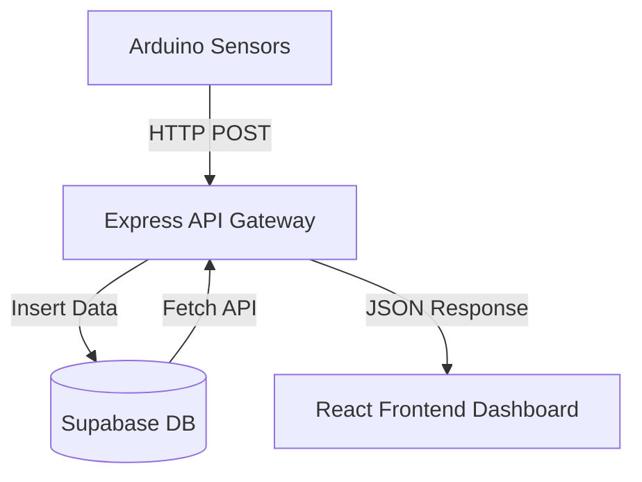

# Implementation Plan: Plant Doctor Pro

This document maps out the roadmap for fully integrating the Arduino hardware layer, the Supabase PostgreSQL database, the Node.js/Express API gateway, and the React front-end dashboard.

---

## Roadmap Overview



---

## Step-by-Step Execution Plan

### Phase 1: Database Provisioning (Supabase)
Prepare the database tables and reference nodes for the devices.
1.  Log in to your **Supabase Dashboard** and create a new project.
2.  Navigate to the **SQL Editor** tab.
3.  Execute the script in [schema.sql](file:///c:/Users/yeesm/Work/arduino/plant-doctor-pro/web/backend/database/schema.sql) to generate the tables (`devices`, `plant_data`, `care_suggestions`).
4.  Execute the seed script in [mock_data.sql](file:///c:/Users/yeesm/Work/arduino/plant-doctor-pro/web/backend/database/mock_data.sql) to set up test devices and preliminary entries.
5.  Retrieve your **Supabase API URL** and **Service Role API Key** from the project settings.

### Phase 2: Express Backend Environment Configuration
Configure and start the middleware API.
1.  Navigate to [web/backend](file:///c:/Users/yeesm/Work/arduino/plant-doctor-pro/web/backend).
2.  Create a `.env` file containing:
    ```env
    SUPABASE_URL=YOUR_SUPABASE_PROJECT_URL
    SUPABASE_KEY=YOUR_SUPABASE_SERVICE_ROLE_OR_ANON_KEY
    ```
3.  Open a terminal inside [web/backend](file:///c:/Users/yeesm/Work/arduino/plant-doctor-pro/web/backend) and run:
    ```bash
    npm install
    npm run server
    ```
4.  Verify that the server launches successfully on `http://localhost:3000` and displays:
    `Server running on http://localhost:3000`
5.  *(Optional)* Test the REST endpoint using curl, Postman, or a browser:
    `GET http://localhost:3000/api/sensor-data`

### Phase 3: Firmware & Arduino Sensor Integration
Complete the micro-controller logic to connect to WiFi and transmit actual metrics.
1.  Open the [arduino](file:///c:/Users/yeesm/Work/arduino/plant-doctor-pro/arduino) folder.
2.  Configure your local wireless SSID credentials in [wifi_connection.ino](file:///c:/Users/yeesm/Work/arduino/plant-doctor-pro/arduino/wifi_connection.ino).
3.  Complete [plant_doctor_pro.ino](file:///c:/Users/yeesm/Work/arduino/plant-doctor-pro/arduino/plant_doctor_pro.ino):
    *   Integrate library inclusions for your sensors (e.g. DHT11 temperature/humidity, soil moisture pin reads, light sensor, tilt switch).
    *   In `setup()`, call the WiFi initialization routine.
    *   In `loop()`, poll sensor values every $N$ seconds.
    *   Formulate a JSON string matching the expected backend input format:
        ```json
        {
          "device_id": "YOUR_DEVICE_UUID_FROM_SUPABASE",
          "moisture": 62.0,
          "light": 3400.0,
          "temperature": 22.4,
          "plant_status": "Thriving"
        }
        ```
    *   Execute an HTTP `POST` request to `http://<YOUR_BACKEND_IP>:3000/api/sensor-data` to submit the payload.

### Phase 4: Frontend Live Integration
Shift the dashboard from static mock data to dynamically fetching database logs.
1.  Update the fetch client configuration in [dashboard.ts](file:///c:/Users/yeesm/Work/arduino/plant-doctor-pro/web/frontend/src/app/api/dashboard.ts):
    *   Dynamically load the `device_id` relative to the selected plant/device.
2.  Update the components to ingest dynamic state instead of loading static mock data from [mock-plant.ts](file:///c:/Users/yeesm/Work/arduino/plant-doctor-pro/web/frontend/src/app/data/mock-plant.ts):
    *   Implement loading states and try/catch blocks for error boundaries.
    *   Configure dynamic ranges (7D/30D/90D) to request corresponding historical date-truncations from the backend.
3.  Integrate the visual dark botanical theme. In [App.tsx](file:///c:/Users/yeesm/Work/arduino/plant-doctor-pro/web/frontend/src/app/App.tsx), change:
    *   `background: "#F4F7F2"` $\rightarrow$ `background: "var(--plant-bg)"` (`#0D1F17`)
    *   `color: "#1A2E22"` $\rightarrow$ `color: "var(--plant-text)"` (`#F0EDE6`)
    *   Update card backgrounds from `#FFFFFF` to `var(--plant-card)` (`#1A3828`) and borders to `var(--plant-border)` (`#2D5A3D`) to fulfill the forest green theme guidelines.
4.  Navigate to [web/frontend](file:///c:/Users/yeesm/Work/arduino/plant-doctor-pro/web/frontend) and run:
    ```bash
    npm install
    npm run dev
    ```
5.  View the live dashboard at the URL provided by Vite.
